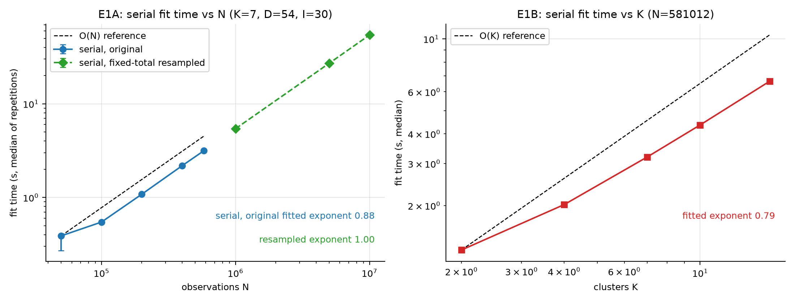
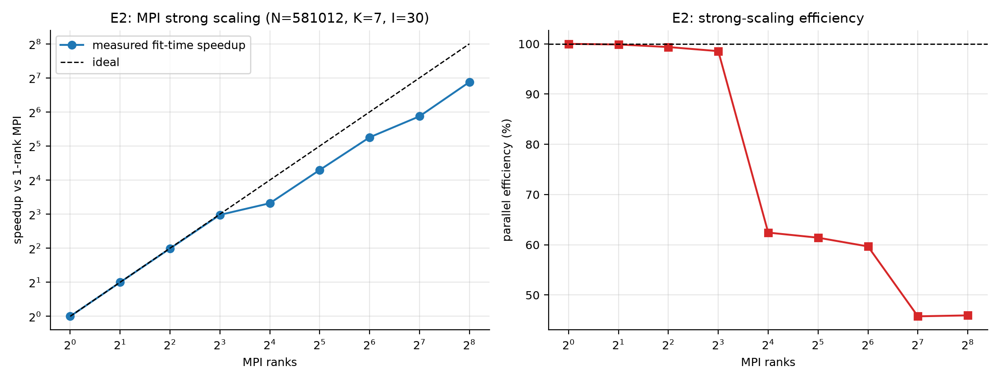
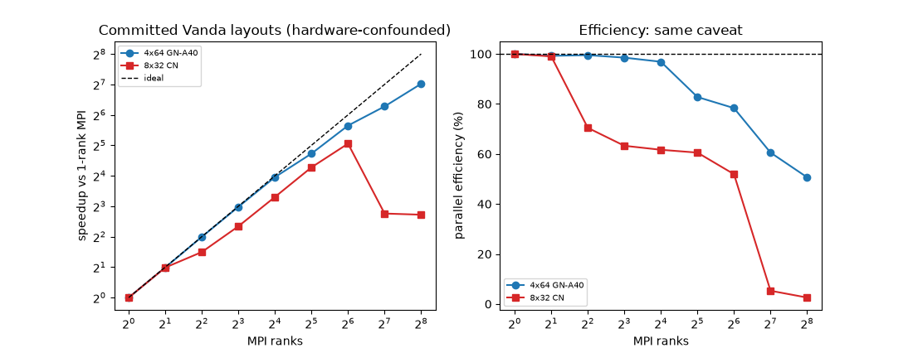
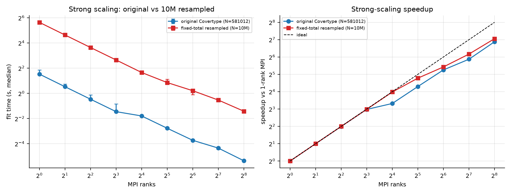
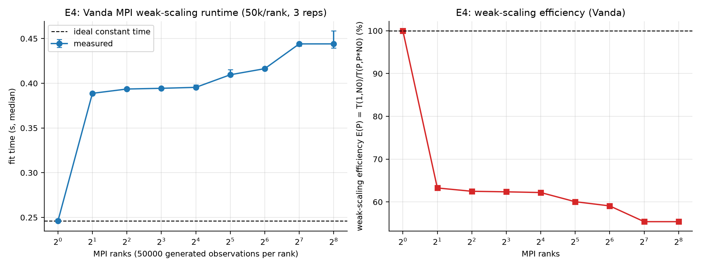
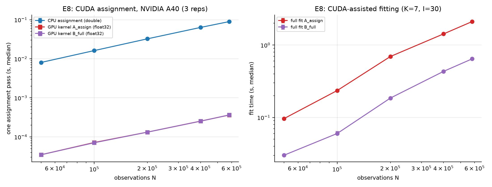
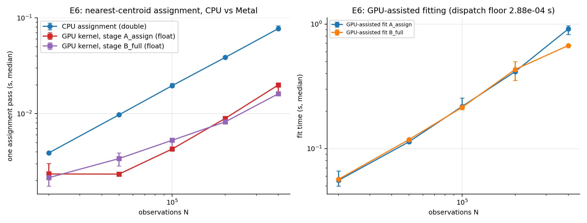
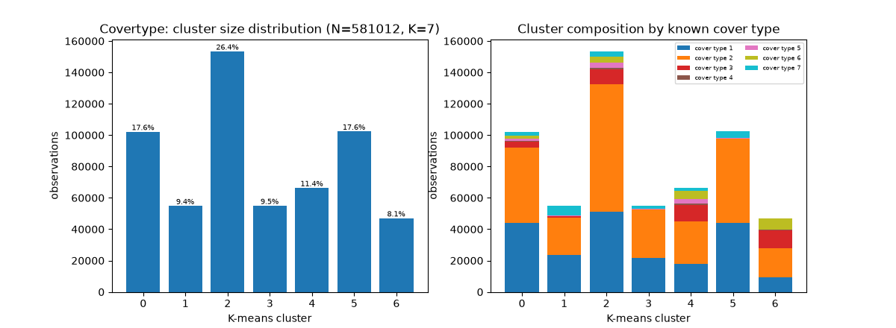

# DSA5208 Project 3 — Report Draft (2026-11-14)

Status: working draft. Every number is from a measured CSV/log listed in
`docs/RESULT_VALIDATION.md`. Sections whose repaired campaign is still queued
are marked **PENDING**; no value is invented.

## 1. Introduction

K-means is data-parallel in its assignment step but requires a global
synchronisation for every centroid update. This project implements the same
Lloyd algorithm in serial C++, OpenMP, MPI, hybrid MPI+OpenMP, Apple Metal and
NVIDIA CUDA, and studies correctness, strong scaling, weak scaling, the
rank/thread ratio, communication cost and real-data cluster meaning on the UCI
Covertype dataset (581,012 observations, 54 features, K = 7).

The primary HPC platform is NUS Vanda (PBS Pro, Intel Xeon Platinum 8452Y
nodes). The main experimental unit is `fit_s`: `MPI_Wtime`/`steady_clock`
around the Lloyd iteration loop, with the maximum rank time used for MPI.
Loading, preprocessing, k-means++ and final validation are reported separately
and never folded into `fit_s`.

## 2. Algorithm

For observations `x_i` and centroids `c_k`:

1. **Assignment**: `a_i = argmin_k ||x_i - c_k||^2`, ties broken by the lowest
   cluster id.
2. **Update**: `c_k = sum_{i:a_i=k} x_i / |{i:a_i=k}|`; an empty cluster keeps
   its previous centroid.

Stopping is `changed == 0` over the whole dataset (or a fixed iteration budget
for performance runs). The objective is the inertia
`SSE = sum_i ||x_i - c_{a_i}||^2`.

Preprocessing: the first 10 continuous features are z-scored with the
population standard deviation; the 44 binary wilderness/soil indicators remain
0/1. K-means++ with `std::mt19937_64`, seed 42, chooses initial centroids.
For fixed-total resampled workloads, the initial centroids are computed once on
the preprocessed Covertype source and reused for every rank count.

## 3. Parallelisation design

* **Serial/OpenMP**: one fused assignment+accumulation pass. OpenMP uses
  `schedule(static)`, thread-private `K x D` sums and `K` counts, then a
  deterministic fixed-thread-order fold. No atomics.
* **MPI**: contiguous observation blocks (`base = N/P`, first `N%P` ranks get
  one extra row). Two `MPI_Allreduce` calls per iteration: `K*D` doubles for
  sums and `K+1` uint64 for counts/changed labels. Every rank computes the
  same centroids. For K=7, D=54, the sum message is only 3,024 bytes, so the
  cost is latency and synchronization, not bandwidth.
* **Hybrid**: MPI decomposition plus an OpenMP team per rank. Thread-local
  totals are folded in fixed thread-id order, then the main thread calls MPI.
  `MPI_Init_thread` requests `MPI_THREAD_FUNNELED`; the program aborts if that
  level is unavailable and re-checks with `MPI_Query_thread`.
* **Fixed-total resampling**: global index → source row via SplitMix64:
  `splitmix64(gi*0x9E3779B97F4A7C15 ^ splitmix64(seed^0x5DEECE66D)) mod source_rows`.
  Every rank materialises only its block. The mapping depends on
  `(seed, gi, source_rows)`, never on P, so 1 and 256 ranks process identical
  rows with identical initial centroids. The data are resampled real Covertype
  rows, not new forest observations.
* **GPU**: only the assignment kernel runs on the device. CUDA uses float32
  device arithmetic and keeps accumulation/centroids in double on the host;
  Metal does the same on Apple silicon. Correctness is tolerance-based.

## 4. Experimental methodology

* Hardware: Vanda Intel Xeon Platinum 8452Y nodes, 64/72 cores, SMT off;
  GCC 11.4/11.5, OpenMPI 4.1.8, `-O3 -std=c++17 -DNDEBUG`.
* K=7, D=54, seed=42, I=30 fixed iterations for performance; 3 repetitions,
  median reported. Real-data analysis uses convergence stopping.
* Strong speedup `S(P)=T(1)/T(P)`, efficiency `E(P)=S(P)/P`. Weak efficiency
  `Eweak(P)=T(1,N0)/T(P,P*N0)`, with the 1-rank MPI run as baseline.
* `mpi_reduction_s` is collective latency including waiting for the slowest
  rank; it is not labelled network bandwidth.
* No Atlas/Mac/Vanda numbers are mixed into one unqualified curve.

## 5. Correctness

Vanda 12-core gate (job 1552574):

| Check | Result |
|---|---|
| 20k Covertype, 10 fixed iterations | serial, OpenMP 2t, MPI 2r, hybrid 2×2 all hash `13331398156540273710` |
| `--resampled-total 200003`, K=7, 8 iterations | serial, OpenMP 4t, MPI 1/2/4, hybrid 2×2 all hash `827501680209798837`, inertia `1315780.854940` |
| weak identity | 1×20000 and 4×5000 both hash `4563062909436114682` |
| two-node MPI | 4 ranks over 2 hosts, local = distributed hash `16916848538625945915` |

The converged serial run reproduced inertia `3722934.178255`. A separate
recomputation from the saved centroids gives `3722934.178252` (rounding),
confirming the centroid file matches the C++ result. The repaired E0 gate
repeats these checks on the current binaries before production.

Tolerances: label hashes and cluster sizes exact; inertia/centroids
tolerance-based because reduction order differs. No bitwise equality is
required across ranks/threads.

## 6. E1 — serial scaling

Vanda, 1 core, K=7, D=54, I=30, median of 3.

| Data | N | fit_s | total_s | generation_s |
|---|---:|---:|---:|---:|
| original | 50,000 | 0.389 | 1.318 | 0 |
| original | 100,000 | 0.546 | 1.234 | 0 |
| original | 200,000 | 1.083 | 1.834 | 0 |
| original | 400,000 | 2.184 | 3.055 | 0 |
| original | 581,012 | 3.185 | 4.146 | 0 |
| resampled | 1,000,000 | 5.420 | 6.597 | 0.135 |
| resampled | 5,000,000 | 27.072 | 29.414 | 0.668 |
| resampled | 10,000,000 | 54.254 | 58.057 | 1.339 |

Fitted log-log exponent for the resampled N series is **1.00**, the expected
O(N) behaviour for fixed K, D and I. The K sweep at N=581,012 (2,4,7,10,16) has
exponent **0.79**, below 1 because the per-observation accumulation over D does
not grow with K while the number of distance evaluations does.



## 7. E2 — original MPI strong scaling

Two committed Vanda shapes exist, and they are not a clean node-count
comparison:

| Layout | Rank 1 fit | 256-rank fit | Speedup | Efficiency | Collective at 256 |
|---|---:|---:|---:|---:|---:|
| 4×64 (GN-A40-051) | 2.887 s | 0.0223 s | 129.7× | 50.7% | 0.0097 s |
| 8×32 (CN-006) | 2.883 s | 0.4374 s | 6.59× | 2.6% | 0.4231 s |

Both have the same label hash `15912193932519828622`, so the difference is not
numerical. The 8×32 loss is almost entirely collective latency: at 128 ranks
the Allreduce takes 0.399 s of a 0.426 s fit. The two jobs landed on different
node families (GN-A40 vs CN), so hardware, interconnect and placement are
confounded. This is reported as a topology observation, not as “4 nodes are
faster than 8”.

The own-account heterogeneous 256-core run (job 1552672) gives 117.6× / 45.9%
and the same hash; it is a valid legacy point but mixes 72/56/32/24-core
fragments. A homogeneous 4×64 E2 rerun is part of the repaired campaign.





## 8. E3 — large 10M MPI strong scaling

Job 1552703, 4×64 GN-A40 nodes, fixed N=10,000,000 generated by
`--resampled-total`, 27/27 rows, all rank counts hash
`14076111245358280480`.

| Ranks | fit_s | Speedup | Efficiency |
|---:|---:|---:|---:|
| 1 | 49.805 | 1.00 | 100% |
| 2 | 24.879 | 2.00 | 100.1% |
| 4 | 12.478 | 3.99 | 99.8% |
| 8 | 6.287 | 7.92 | 99.0% |
| 16 | 3.154 | 15.79 | 98.7% |
| 32 | 1.812 | 27.48 | 85.9% |
| 64 | 1.158 | 43.01 | 67.2% |
| 128 | 0.692 | 71.94 | 56.2% |
| 256 | 0.374 | 133.03 | 52.0% |

The larger workload holds high efficiency to 16 ranks, then communication and
the fixed serial fraction dominate. The 10M curve is visibly better than the
581k curve at the same rank count, which is the expected compute-to-
communication trade-off.



## 9. E4 — MPI weak scaling

Own 5-node heterogeneous 256-core run (job 1552672): every rank owns 50,000
observations, up to 12.8M logical rows. 27/27 rows, 30 iterations.

| Ranks | Rows | fit_s |
|---:|---:|---:|
| 1 | 50,000 | 0.2459 |
| 8 | 400,000 | 0.3942 |
| 32 | 1,600,000 | 0.4092 |
| 64 | 3,200,000 | 0.4150 |
| 128 | 6,400,000 | 0.4416 |
| 256 | 12,800,000 | 0.4440 |

Weak efficiency at 256 = 0.2459/0.4440 = **55.4%** on this heterogeneous
allocation. The committed homogeneous jobs report **80.2%** (4×64 GN-A40,
baseline 0.3946 s) and **35.8%** (8×32 CN, baseline 0.3916 s). These three
baselines are not interchangeable and are not merged into one curve.



## 10. E5 — OpenMP-only scaling

**PENDING** — `e5_openmp_hc.pbs` sweeps 1,2,4,8,16,32,64 threads on one 64-core
node for original 581k and 10M, 3 reps each. It verifies every reported thread
count. No OpenMP numbers are invented here.

## 11. E6 — hybrid MPI+OpenMP

**PENDING repaired run, and the old rows are INVALID.** The old 256-core hybrid
CSV (job 1554129) has 21 rows but 256×1 fit values 0.0273/0.7690/1.0875 s and
8×32 values around 3.5 s; the 128-core job 1552704 produced no rows and zero
CPU time. Root cause is the Vanda launch mapping: `ppr:R:node:pe=T` with
`--bind-to core` hangs under OpenMPI 4.1.8 + PBS TM. The repair uses the mapping certified by E0
(`ppr:R:node`/`node`/`slot` with `--bind-to none`), `OMP_PROC_BIND=false`, a one-iteration preflight
and a 180 s timeout per run, with worker-count verification. Independent
64/128/256-core jobs are prepared but not yet submitted while the Vanda PBS
server is unreachable; no hybrid conclusion is claimed until they produce
valid rows.

## 12. E7 — node layout and communication

**PENDING** — the repaired diagnostic reruns 128/256 ranks on one 8×32 CN
allocation with `--map-by core`, `ppr:32:node` and `ppr:16:node`, and prints
per-host rank counts. Until then the 4×64 vs 8×32 difference is explicitly
labelled hardware/placement-confounded.

## 13. E8 — GPU evaluation

**CUDA (NVIDIA A40, 30 rows):** stage A re-uploads the matrix every iteration;
stage B keeps it resident. Label agreement is 1.0 for 50k/100k/200k/581k and
0.9999875 at 400k; max centroid difference 8.54e-5; max relative inertia
difference 3.2e-8. At 581,012 the stage-B full fit is 0.644 s and the GPU
kernel is ~0.016 s per assignment, against a CPU assignment pass of ~0.076 s.
Kernel-only time is never compared with CPU end-to-end time.



**Apple Metal (M1 Pro, 30 rows):** label agreement 1.0 at every size.
Stage-B full fit is 0.673 s at 400k vs 0.915 s for stage A; the GPU kernel is
0.020 s vs 0.079 s CPU assignment. Metal is float32 on a different platform,
not a Vanda scaling point.



## 14. E9 — real-data Covertype conclusions

Converged serial run: 46 iterations, inertia **3,722,934.178255**.

| Cluster | Size | Share | Majority type | Purity |
|---|---:|---:|---:|---:|
| 0 | 102,132 | 17.6% | 2 | 0.471 |
| 1 | 54,851 | 9.4% | 2 | 0.434 |
| 2 | 153,387 | 26.4% | 2 | 0.531 |
| 3 | 54,961 | 9.5% | 2 | 0.560 |
| 4 | 66,308 | 11.4% | 2 | 0.414 |
| 5 | 102,343 | 17.6% | 2 | 0.522 |
| 6 | 47,030 | 8.1% | 2 | 0.389 |

Agreement with the seven known cover types is low: **ARI = 0.0191**,
**NMI = 0.0562**, **AMI = 0.0562**. Every cluster is majority Lodgepole Pine
(type 2, 48.7% of the data), and type 1 is split across all seven clusters.
Some structure remains: cluster 4 is 45% type 4 and 27% type 6; cluster 6 is
39% type 6 and 32% type 3; cluster 3 is mostly types 1/2 with a high mean road
distance.

Interpretation: unweighted Euclidean K-means on 10 z-scored continuous
features plus 44 binary indicators is dominated by the large classes and the
binary soil/wilderness dimensions. It does not recover the seven cover types.
This conclusion uses only the 581,012 real observations; resampled benchmark
data are never used for it.



## 15. Discussion

* Strong scaling falls when per-rank work becomes comparable to collective
  latency. At 256 ranks the original 581k workload has only 2,269 rows/rank;
  the 10M workload has 39,063 rows/rank and keeps 52% efficiency.
* The global sum is tiny (3 KB), so the cost is synchronization latency, not
  bandwidth. `mpi_reduction_s` therefore measures collective latency including
  rank imbalance, not network throughput.
* Hybrid is not assumed to beat MPI-only. Fewer ranks reduce collective
  traffic, but OpenMP thread reduction and idle threads at barriers can offset
  the gain. Only valid, equally provisioned layouts may be compared.
* The 4×64 vs 8×32 difference is not a node-count law until E7 separates
  placement from hardware family.
* CPU binding matters: `pe=` mapping hangs on this launcher; `ppr` without
  `pe=` plus an exclusive allocation is the tested safe path.

## 16. Limitations

* 256-core homogeneous jobs depend on Vanda's batch queue; only measured rows
  appear in final tables.
* The legacy 256-core weak run uses a heterogeneous 5-node allocation; it is
  labelled as such and not merged with homogeneous curves.
* Fixed-iteration benchmarks measure throughput, not clustering quality.
* Resampled data repeat real source rows; their inertia is not a property of
  new forest observations.
* CUDA/Metal use float32 kernels; comparisons are tolerance-based.
* The E6/E2/E5/E7 repaired jobs were submitted after the audit; any section
  still marked PENDING must remain incomplete in the final PDF.

## 17. AI-use declaration

An AI coding agent inspected the repository and logs, recovered the lost
fixed-total resampling from a local stash, repaired the hybrid launcher and
build/timeout handling, wrote the Vanda job kit and validation scripts, ran
the local and HPC checks, and generated the measured tables/figures. All
performance numbers are from executed jobs; no benchmark value was generated
or interpolated by the agent. Human review is required before submission.

## 18. Reproduction

```
ssh harry_chen@vanda.nus.edu.sg
cd /scratch/harry_chen/DSA5208_Proj3
qsub -P personal-harry_chen jobs/vanda/e0_gate_hc.pbs
# after E0 passes:
qsub -P personal-harry_chen -W depend=afterok:<E0> jobs/vanda/e2_strong_hc.pbs
qsub -P personal-harry_chen -W depend=afterok:<E0> jobs/vanda/e5_openmp_hc.pbs
qsub -P personal-harry_chen -W depend=afterok:<E0> jobs/vanda/e6_hybrid_64_hc.pbs
qsub -P personal-harry_chen -W depend=afterok:<E0> jobs/vanda/e6_hybrid_128_hc.pbs
qsub -P personal-harry_chen -W depend=afterok:<E0> jobs/vanda/e6_hybrid_256_hc.pbs
qsub -P personal-harry_chen -W depend=afterok:<E0> jobs/vanda/e7_layout_hc.pbs
```
